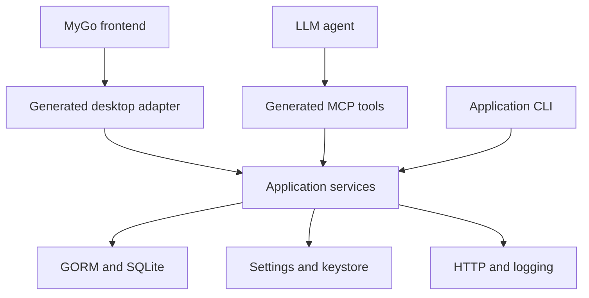

# MyGo application framework implementation plan

Build a reusable Go application framework for MyGo, inspired by Goravel's conventions and development experience. The framework owns application structure, local persistence, validation, service composition and tooling. MyGo owns the desktop runtime and UI integration. Goravel is a design reference only and must not be a dependency.

The goal is to make the normal feature path fast and predictable for both developers and LLM agents. Deliver a working reference app early, then extract and extend the framework around it. This plan covers the requested feature set in eight bounded milestones.

Prepared 22 October 2026. Package selections are decisions for this implementation. Public API examples and the executable name `framework` are proposed interfaces, not existing software.

# Decisions and scope

| Requested capability | Initial implementation |
| --- | --- |
| Persistent configuration | Typed settings with SQLite as the default backend and an optional bbolt adapter |
| OS keystore | Small application-scoped wrapper around MyGo Secrets |
| ORM | GORM with the ncruces gormlite SQLite driver |
| Migrations | Embedded, versioned SQL migrations through Goose |
| DI and services | samber/do v2 at the composition boundary, ordinary constructor injection in services |
| Logging | Go slog, consistent context fields, development stderr and rotating local file output |
| Forms | Small framework-neutral TypeScript form state and submission helper |
| Request helpers | Typed application requests plus a configured Resty v2 outbound HTTP client |
| Service layer | Ordinary Go services with typed input/output and validation at public feature entry points |
| Validation | go-playground/validator v10 with structured field errors |
| Generators | Deterministic Go templates and source inspection |
| CLI | Cobra commands for scaffolding, generation, MyGo delegation and app command helpers |
| MCP generation | Explicitly selected service methods become typed tools using the official Go MCP SDK |

SQLite is the default because applications using the ORM already need it. bbolt is an alternative for settings, especially for apps without relational data; it does not replace the ORM's SQL database. Supporting both adapters is in scope, but the reference app uses SQLite.

Form helper means submission state and validation errors for MyGo web frontends. Native Go views use the same services and error types directly. MCP means application tools such as listing and creating notes; screenshots, clicking and visual UI inspection are outside this implementation.

Build one Go module with separate packages and one small TypeScript helper package. Optional adapters must be selected by imports and explicit bootstrap registration. Do not split every component into a separately released module.

# Selected packages

Pin compatible tagged releases during milestone 1 and record them in go.mod and the frontend lockfile. Match MyGo's supported Go toolchain; its current documentation requires Go 1.27 or later. Do not use moving branches or introduce a release candidate merely because it has newer documentation. [S1]

| Area | Package or existing capability | Integration rule |
| --- | --- | --- |
| Desktop | github.com/egoist/mygo | Keep its event loop, bindings, native APIs, development workflow and packaging |
| ORM | gorm.io/gorm | Expose GORM directly; no replacement query language or generic repository layer |
| SQLite | github.com/ncruces/go-sqlite3/driver and github.com/ncruces/go-sqlite3/gormlite | One shared database/sql pool; preserve builds with CGO_ENABLED=0 |
| Migrations | github.com/pressly/goose/v3 | Use the library provider, not its multi-driver CLI |
| Optional settings store | go.etcd.io/bbolt | Single owning process, bounded open timeout |
| DI | github.com/samber/do/v2 | Explicit registration, provider factories and dependency-aware disposal |
| Logs | log/slog and gopkg.in/natefinch/lumberjack.v2 | Standard logger plus an existing rotating writer |
| Validation | github.com/go-playground/validator/v10 | JSON field names and stable application error codes |
| HTTP | github.com/go-resty/resty/v2 | Stable v2 for the initial implementation |
| CLI | github.com/spf13/cobra | Use Cobra commands and flags directly |
| Code inspection | golang.org/x/tools/go/packages and Go AST/type packages | Generator-only imports; do not execute app code |
| MCP | github.com/modelcontextprotocol/go-sdk/mcp | SDK transport, type-derived schemas and tool registration |

The ncruces driver provides database/sql and GORM integration without CGO. Its current implementation translates a Wasm SQLite build to Go and notes additional memory cost per connection. gormlite accepts an existing database handle, and Goose accepts an existing sql.DB plus an embedded migration filesystem. Prove the combination with a small test before building the remaining framework. [S5] [S6] [S7]

Use samber/do instead of implementing a dependency resolver. Its typed API still requires runtime validation of registrations and dependencies. Services receive normal constructor arguments; only provider factories and composition code resolve from the container. [S8]

Viper is not needed for the database-backed settings service. Its configuration-source features do not provide the requested SQLite/bbolt persistence. Implement explicit flag/environment overlays on typed settings, without creating a general configuration language. [S12]

# Architecture

The service layer is the shared application API. UI and MCP adapters reuse it, including validation, transaction boundaries and application errors.



A request flows through readiness checks, service input validation, the feature implementation and transport-specific result mapping. Keep these responsibilities small. There is no requirement for separate controller, action, use-case, repository and domain-event classes for every feature.

## Framework package boundaries

The core runtime, settings contracts, validation, errors and service helpers must be testable without importing or starting MyGo. The MyGo adapter supplies platform paths, keystore access, windows and lifecycle hooks.

Keep CLI code, source scanners and templates outside the runtime import graph. Importing core must not automatically import every database backend, MCP or a frontend framework.

Use one dependency owner for every closable resource. The SQLite pool owner closes it; GORM, migrations and settings borrow it. Registering the same pool in several adapters must not lead to several Close calls. Goose Provider.Close closes the supplied pool: do not defer it after migration or register it as a second cleanup when the runtime owns that pool. [S7]

## Generated application layout

| Location | Responsibility |
| --- | --- |
| main.go | MyGo entry point and explicit generated bindings |
| app/bootstrap/ | Provider registration, identity, runtime options and selected adapters |
| app/services/ | Feature implementation and constructor injection |
| app/requests/ | Typed inputs and validation tags |
| app/models/ | GORM persistence models |
| app/desktop/ | Generated frontend adapters and concrete wire response types |
| app/mcp/ | Generated registrations for explicitly selected tools |
| app/commands/ | App-specific Cobra commands when needed |
| database/migrations/ | Embedded SQL migration history |
| src/ or the existing frontend directory | Existing MyGo frontend and form helper usage |
| cmd/appctl/ | Non-GUI application commands |
| AGENTS.md | Short feature recipe and project boundaries |

Preserve MyGo's supported entry point and frontend layout. Adapt an existing app without moving its whole UI. Generated app CLI code uses the same profile/path configuration as the desktop app; its help and generation commands must not open app storage.

# MyGo integration contract

MyGo binds exported Go methods and generates TypeScript from them. Its generator runs main up to App.Run, and bound method contexts are canceled when the calling page goes away. The framework must accommodate these behaviors rather than replace them. [S2]

## Registration and startup

1. Before App.Run, describe providers, register narrow desktop adapter objects and register MyGo callbacks. This stage must not open storage, access the keyring, create logs, run migrations or start network listeners.
2. Keep App.Run on the main goroutine. On actual readiness, begin slow runtime startup in a background goroutine; the UI can show a simple starting state. [S3]
3. Resolve the selected user-data paths, open logging and storage, run pending migrations, load settings, construct required services and start explicitly enabled workers/adapters.
4. Publish either a ready runtime or a startup failure through a synchronized readiness mechanism. Every entry point uses it. A request during startup can wait with its context; after failed startup it returns an unavailable error.
5. Only enable MCP after the shared services are ready.

Avoid import-time init functions that perform work. A bound adapter may hold a runtime reference before resources exist; it must not resolve a service merely to register its method signatures.

The production binding set and generation binding set must be identical. Do not skip binding declarations when MYGO_GENERATE is present. No helper may call os.Exit or log.Fatal inside the framework library.

## Shutdown and context ownership

Use one application context for app-lifetime tasks and each incoming request's context for request-lifetime work. A window closing must not accidentally cancel a separately launched application task.

Shutdown rejects new requests, stops MCP and background work, waits with a bounded deadline, then releases services and storage. Keep waiting off the UI thread. Use a cancelable MyGo quit stage to keep the process alive while cleanup runs, then resume quitting with a re-entry guard. Cleanup must finish or hit its deadline before App.Run returns; launching it from OnQuit alone is too late. Teardown is idempotent and startup failures release resources that actually opened.

Do not put Start, Stop, Close or provider registration methods on the type passed to mygo.Bind. MyGo exposes every exported method of a bound object; only intended UI operations belong there. [S2]

Use actual MyGo data/cache/log paths at the desktop edge and inject them into core services. Respect development/production separation and explicit path overrides. Do not derive runtime storage from the current working directory. [S3]

# Component contracts

## Persistent configuration

Separate immutable bootstrap options from user settings. App identity, storage backend and data directory must be known before opening the settings store.

Implement a small store contract for reading, writing and deleting JSON values. Add typed top-level helpers such as Get[T] and Set[T] using registered Key[T] definitions. Keys have a name, a default and optional validation. Unknown keys and incompatible values return clear errors.

Required behavior:

- A missing key returns its declared default; false, zero and empty strings remain valid stored values.
- Invalid persisted JSON or the wrong type produces a contextual error, not a silent reset.
- A write validates before commit and returns only after persistence succeeds.
- Reads and writes are safe across goroutines. Keep the first version free of an additional mutable cache.
- Precedence is explicit flags, explicitly mapped environment values, persisted settings, then defaults. Flag/environment overrides are transient and never silently saved.
- Store secrets through the separate secret API, not ordinary settings.

SQLite stores settings in one framework-owned namespaced table in the application's database. Create that table through a versioned migration, and keep its names separate from application tables.

The optional bbolt adapter uses one bucket and the same JSON representation. Copy returned bytes before a transaction ends, use a bounded open timeout and close the database once. A second process must receive an actionable busy error rather than wait indefinitely. bbolt's process lock is why the MCP design shares the original application runtime. [S9]

Backend choice is fixed for an app installation in v1. Automatic conversion between bbolt and SQLite, cross-device settings sync and file watchers are not part of this work.

## OS keystore

Expose a small SecretStore interface with Get, Set and Delete. The desktop adapter delegates to MyGo Secrets and uses a stable app/environment namespace. Preserve missing-secret and OS-unavailable errors.

MyGo already uses the platform credential stores: macOS Keychain, Linux Secret Service and Windows Credential Manager. It also documents portable size limits. Reuse that behavior; do not reimplement platform APIs. [S4]

Do not silently write plaintext secrets if the OS store is locked or missing. Tests use an in-memory adapter, while each supported desktop OS gets a small real-store smoke check when the environment permits it.

The core and non-GUI tools accept an injected SecretStore. Do not promise GUI-independent access to MyGo's platform APIs; verify it before enabling secret-dependent app CLI commands. Keystore administration commands are not a v1 requirement.

## Database and migrations

Open one shared sql.DB using ncruces. Pass it to gormlite.OpenDB and a Goose provider. Use a conservative pool size initially, with foreign keys and bounded busy waiting configured for every connection. Verify WAL support with the pinned driver before enabling it. [S5] [S6] [S7]

Use GORM's context-aware APIs and return ordinary errors. Transactions belong to service methods. Code inside a transaction uses the transaction handle; it must not accidentally reacquire the root pool.

Goose SQL migrations are the schema authority. Embed them into the application and apply pending forward migrations before declaring readiness. Keep migration identity/order stable and record applied state in the database. A failure leaves the application unavailable with the failing migration identified.

Expose migration status and up through app CLI helpers. Do not silently repair or reset a database, rewrite applied migrations, or use AutoMigrate as a competing schema mechanism. No generated SQL triggers.

MyGo's own SQLite plugin is a different API. The framework does not open an additional plugin connection for the same application data; desktop UI calls the service layer. Existing projects using that plugin need an explicit migration decision, not an automatic conversion.

## DI and service layer

Use samber/do v2 with explicit providers. No global facade registry or container lookups inside business methods.

Constructors declare dependencies directly, such as a GORM handle, logger and settings service. Provider factories resolve and pass those dependencies. Startup resolves the required graph so missing registrations fail before the first user interaction.

Do not require every service to implement lifecycle methods. Register startup/cleanup behavior only for components that own resources or background work. Use the container's dependency-aware disposal where applicable, with the runtime owning the final ordering around MCP, jobs and stores.

Use concrete service types by default. Add interfaces at actual substitution boundaries, including settings/keystore adapters or external dependencies being replaced in tests.

## Validation and application requests

Use validator v10, initialized with required-struct behavior enabled. Map validation failures to JSON field names, including nested fields, and provide a stable field-error representation. [S10]

Public feature methods validate their inputs at the service entry point through the shared helper. This ensures desktop, MCP and CLI callers receive the same domain behavior. Transport decoding and MCP schema validation remain separate from domain validation.

Start with these application error codes: validation, not_found, conflict, unavailable, canceled and internal. Preserve the underlying Go cause for logging and errors.Is/errors.As. Add codes only when a real feature requires them.

Use a concrete Problem type with code, message and fieldErrors. Unexpected errors receive a useful operation identifier in logs and a suitable user message. Do not return raw database errors or credentials to forms.

MyGo turns ordinary returned errors into rejected calls with an error message. Therefore generate concrete per-operation wire responses containing Data and Problem, instead of assuming an arbitrary Go error's fields survive the IPC boundary. Use pointers with JSON names data and problem: success has non-nil Data and nil Problem; failure has nil Data and non-nil Problem. Use concrete named types initially; verify generic wire types separately before depending on them. [S2]

## Forms and frontend requests

Provide one small TypeScript package with no React/Vue dependency. It consumes the TypeScript types MyGo already generates.

The form helper supplies values, dirty state, touched fields, submitting state, field errors, form error, reset, setField, subscribe and submit. It calls a typed generated desktop method and maps its Problem into form state.

Prevent duplicate submissions while submitting. Reset state correctly after both success and failure, and ignore obsolete completion when a form has been disposed. Do not claim that ignoring a Promise result cancels the underlying Go call.

The frontend request helper unwraps Data/Problem and normalizes unexpected MyGo transport failures. It is not another RPC layer. Backend validation remains authoritative; do not build a compiler that translates every Go validation rule into JavaScript.

Supply a tiny vanilla TypeScript example. Framework-specific hooks, visual form generation, field component libraries and native UI form renderers are outside v1.

## Outbound HTTP requests

Provide a configured stable Resty v2 client with per-request context, configurable timeout, base URL, headers, JSON encoding/decoding and consistent HTTP error handling. Allow a supplied transport for local tests. [S11]

Retries default to off. Allow explicit bounded retries for appropriate requests; do not retry writes automatically. Cancellation and timeout must reach the request. Record operation, host, status and duration without logging authorization headers or request/response bodies by default.

Keep access to the underlying Resty client. Do not wrap its complete API or add service discovery, circuit breakers or another middleware framework.

## Logging

Inject slog.Logger directly. Development logs go to stderr; packaged apps also have a configured rotating file under the app's log directory. Use an existing rotation writer and expose its basic retention options. [S13] [S14]

Include operation, component, duration and useful identifiers where available. Services add context to errors; adapters log an unexpected failure once. Normal cancellation should not create an error storm.

Route ORM, migration, HTTP and MCP diagnostic output through the configured logger. Log resource startup/failure and shutdown failure so a broken app is diagnosable. Never log secrets, complete settings values or form payloads automatically.

# Generators and CLI

Use Cobra for help, flags, completion and extension points. App-specific commands can be ordinary Cobra commands that receive the initialized services. Keep generator/help commands independent of runtime startup. [S15]

## Commands to implement

| Command shape | Responsibility |
| --- | --- |
| framework new NAME | Create one supported MyGo web app template with framework bootstrap |
| framework dev | Generate required adapters, then delegate development to MyGo |
| framework build | Generate/check adapters, then delegate packaging to MyGo |
| framework make feature NAME | Create the approved input, service, model and migration skeleton |
| framework make service or request or model or migration or command NAME | Create one focused template |
| framework generate | Regenerate desktop adapters and selected MCP registrations |
| framework generate --check | Fail if generated output would change, without writing |
| framework doctor | Delegate MyGo environment checks and report framework configuration issues |
| appctl db status or up | Inspect/apply migrations using the application's shared configuration |

These are proposed command names. Implement their underlying behavior once; avoid multiple competing command syntaxes.

In v1, framework dev generates once before launching MyGo. Scaffolding commands that change exposed declarations run framework generate before reporting success. During development, manual changes to an exposed method's signature or annotations require framework generate in a second terminal, or restarting framework dev; ordinary method-body edits use MyGo's normal rebuild flow. Document this rule explicitly: MyGo's binding regeneration does not regenerate the framework's Go adapters. Framework build always generates before building, and CI uses generate --check to catch stale committed output. Verify the scaffold and manual-regeneration paths with the reference app. Do not add a second file watcher in v1.

Offline database commands run with the desktop app closed in v1. Use the same application profile/path resolver and accept an explicit data-directory override. They use a minimal bootstrap containing paths, logging, sql.DB and Goose; they do not start MyGo, resolve feature services, access the keystore or start workers. In particular, db status must never call normal desktop startup or apply pending migrations. Only db up invokes Up. Do not make a second process reach into the running service container or introduce a local RPC protocol for CLI commands.

## Generation rules

Inspect Go source with go/packages and Go type information. Use text/template and go/format for output. Generation must never run application constructors, access the keystore or open a database. [S16]

Support one initial service-method signature: a context.Context, one concrete input struct and a concrete output struct plus error. Reject unsupported signatures with file/line diagnostics. This limitation is for generated adapters, not for private application code.

Use explicit small annotations on feature methods. For example:

```go
// Create creates a note.
// framework:command notes.create
// framework:mcp notes_create readonly=false destructive=false
func (s *NotesService) Create(
    ctx context.Context,
    input CreateNoteInput,
) (NoteView, error) {
    // Shared input validation, then the feature implementation.
}
```

A command marker opts into desktop generation. The separate MCP marker opts into tool exposure. Ordinary exported methods are not automatically registered.

Generate narrow adapters, concrete response types and registration functions. MyGo remains responsible for Go-to-TypeScript binding generation. Do not generate a second TypeScript RPC client.

Generated files carry a standard generated-code header. Stable ordering and formatting must make a second run byte-identical. Replace only generator-owned files. Scaffolding must refuse to overwrite hand-written files and must not erase feature implementation when regenerating.

Handle the initial generation bootstrapping case: a fresh scaffold must generate successfully before adapter files exist. Inspect source packages rather than requiring generated bootstrap imports to type-check first.

# MCP integration

Use the official Go SDK. Its typed AddTool registration derives schemas from Go types; property descriptions can come from jsonschema tags. Generate typed wrappers and registrations rather than a custom schema engine or protocol implementation. [S17]

Tools call the same service instances used by the desktop app. Start one MCP server inside that process, exposed over loopback Streamable HTTP only when explicitly enabled. Reuse the shared runtime for every request.

MCP changes must follow the normal feature event path so an open UI reflects the result. Use a small application callback/MyGo event adapter for the example; a general-purpose event bus is not required.

## Tool and transport rules

- Generate only annotated methods with explicit tool names, descriptions and effect metadata. Reject duplicate names.
- Read-only/destructive annotations inform clients; they are not an authorization mechanism.
- Services keep returning their ordinary output plus error. The MCP adapter maps a non-nil service error through the same Problem mapper as the desktop adapter, builds its concrete tool response, sets IsError and includes concise text plus structured field errors. Do not make business services return desktop envelopes, or report a domain failure as success merely because the adapter's Go transport error is nil.
- Keep MCP disabled by default. Bind to 127.0.0.1 and provide a configurable port plus clear connection instructions.
- Preserve the SDK's localhost Host protection and wrap the handler with Go's cross-origin protection middleware, as recommended by the SDK. [S18]
- Use a per-launch bearer token for the enabled local endpoint. Show connection details through an explicit developer action and keep the token out of normal logs. Do not build users, roles, OAuth or a remote access system.
- Let the SDK handle protocol negotiation. Select its stateless HTTP mode for simple request/response tools; transport statelessness must not reconstruct services or reopen databases.
- Propagate cancellation supported by the pinned SDK. Shut the HTTP server down before closing shared services.

The initial deliverable is application-capability MCP. Do not add stdio forwarding, remote hosting, screenshots, arbitrary shell/SQL execution or an agent permission framework. A client that requires stdio would need a later transport adapter.

# Implementation milestones

Complete these in order. Keep the reference application runnable after each milestone. Checkpoint the work and report what is usable after each one; continue within this scope without asking for approval at every step.

## Milestone 1 Verify the foundation

Create a plain MyGo notes example and a small non-GUI database probe. Pin the selected versions. Verify CGO_ENABLED=0 builds, one shared SQLite pool with GORM and Goose, and one concrete structured response passing through MyGo generation.

Record a comparable baseline for a clean build with dependencies already downloaded, an incremental build after a service edit, startup to ready and packaged size. Use an isolated build cache for clean-build measurements instead of deleting the developer's global cache.

Acceptance: a note can be stored/reloaded in the probe; MyGo generation succeeds without opening storage; actual measurements and toolchain versions are recorded. If an API assumption fails, make the smallest compatible correction and document it before expanding the implementation.

## Milestone 2 Runtime and one complete feature

Implement the minimal runtime, readiness, MyGo adapter, DI composition, slog configuration, database ownership, embedded migrations, service validation and Problem mapping.

Build create/list notes manually using the intended eventual generator shape. Include one cancellable background operation only to prove lifetime and shutdown behavior; do not build a job scheduler.

Acceptance: create/list works in the UI, invalid input produces field errors, data survives restart, startup failure is visible, and quitting releases resources. Unit tests for core run without a GUI.

## Milestone 3 Configuration and secrets

Add typed SQLite settings, transient overlays and the MyGo SecretStore adapter. Add bbolt using the same settings contract and a shared adapter test suite. Keep it optional in the default app's import graph.

Acceptance: values survive restart with either backend; explicit zero values work; invalid values fail; transient overrides do not persist; locked bbolt fails within its timeout; missing/locked keystore errors are useful.

## Milestone 4 Forms and HTTP helpers

Implement the framework-neutral TypeScript form/request helper and configured Resty client. Update the note form to use them. Test HTTP behavior against a local httptest server.

Acceptance: field errors appear on the correct fields, failed submission clears pending state, a second click does not duplicate an active submission, HTTP timeout/cancellation works, and no write retry occurs without explicit configuration.

## Milestone 5 CLI and desktop generation

Implement the commands and templates above, with feature generation as the primary workflow. Generate adapters and provider scaffolding while keeping dependency wiring explicit. Delegate dev/build/doctor to pinned MyGo tooling.

Acceptance: create a fresh project in a temporary directory, generate a second feature, build it, and invoke its method through the real MyGo generated client. Running generation twice produces no diff. --check detects deliberate stale output. Existing feature code remains intact.

## Milestone 6 MCP generation and runtime

Generate selected tools, wire the optional loopback server to the existing runtime, and document connecting one standard MCP client.

Acceptance: the SDK client can list and call a generated tool; validation errors are tool failures with field details; a created note becomes visible in the existing UI; only annotated tools appear; MCP starts no second store; invalid Host/origin/token requests are rejected; shutdown releases the listener.

## Milestone 7 Cross platform verification and performance

Run supported build checks for Windows, macOS and Linux with CGO_ENABLED=0. Run the reference app's startup/create/restart/shutdown smoke flow on available real OS runners, distinguishing compile success from runtime verification.

Measure the plain MyGo baseline, the default framework app, and the app with MCP enabled using the same toolchain and hardware. Show incremental compilation separately from downloads and clean builds. Fix clear accidental regressions, such as generator packages imported at runtime or blocking UI startup.

Acceptance: record measured build/startup/size differences and any unavailable runtime checks. No claims of identical MyGo performance without measurements. Do not start an open-ended optimization or dependency-replacement project.

## Milestone 8 Handoff and bounded cleanup

Finish the reference app, quick start, generated project guidance and focused API examples. Include adding a feature, saving a setting, reading a secret, calling HTTP, defining a migration and exposing an MCP tool.

Acceptance: a developer can create a project and add a working feature from the documented path. Every requested capability in the initial matrix is implemented or explicitly recorded as blocked with evidence. Remove only scaffolding made obsolete by this work.

# Testing and completion rules

Test the framework's contracts and integration points, not the internals of its dependencies.

Required coverage is limited to settings backend consistency, schema upgrade persistence/failure, readiness/startup rollback, one-time resource disposal, validation mapping, generator determinism and preservation of hand-written code, forms state transitions, HTTP cancellation/retry defaults, and one MCP round trip through a real service.

Use actual temporary databases and local HTTP/MCP clients for these boundaries. Use memory implementations for OS-keystore-independent tests. Do not mock the ORM to prove that a mock returns an expected value.

Use race testing where the target toolchain supports it; this test configuration may need CGO even though shipping binaries must compile with CGO_ENABLED=0. Keep production build verification distinct from race-test requirements.

Do not impose arbitrary coverage percentages, duplicate upstream test suites or add tests for trivial getters/templates that the end-to-end generator check already covers. Rerun broader tests only when the changed boundary or a failed gate warrants them.

# Instructions for the implementation agent

1. Read this plan and existing repository instructions before changing code. This authorizes implementation of the listed milestones, not unrelated feature work.
2. Work on one milestone at a time with one primary implementation workstream. Use independent review only for a concrete question; do not create a recursive agent swarm.
3. Keep a short progress file containing completed milestone, current task, actual test commands/results and next action. Do not create competing plans.
4. Follow the selected packages. A dependency change needs a concrete incompatibility or measured problem, documented with the smallest replacement.
5. Preserve MyGo's strengths. Do not fork MyGo, replace its IPC, add a web application server for ordinary UI calls, or write a custom ORM/DI/MCP engine.
6. Keep services ordinary Go. Add an abstraction only when required by a listed adapter or an existing feature. Do not generate repositories, factories or interfaces for everything.
7. Keep error context and operational logging. Return errors from libraries; reserve process exit decisions for executable entry points.
8. Do not add cloud sync, distributed queues, RBAC, plugins, SQL triggers, an admin panel or additional UI frameworks.
9. When acceptance for the milestone passes, checkpoint and move on. Stop only for a concrete blocker that cannot be resolved within the authorized scope.
10. End with a runnable example, exact run/build commands, completed capability matrix, measured performance and any real remaining limitations.

# Definition of done

A fresh generated application builds through MyGo, opens a usable UI, persists application records and settings, can access OS secrets through the adapter, validates forms, performs cancellable HTTP requests, shuts down cleanly, and exposes explicitly generated MCP tools when enabled.

Its application logic lives in ordinary services shared by the UI and MCP. The framework has no Goravel dependency and no mandatory local server for UI calls. SQLite is the default; the bbolt settings adapter passes the same behavior tests. Generators and CLI helpers make a second feature straightforward, with deterministic output and no loss of hand-written code.

# Sources

These primary sources establish the integration constraints and package capabilities. The architecture, scope and milestones above are the proposed implementation.

- [S1 MyGo documentation and requirements](https://mygo.egoist.dev/docs)
- [S2 MyGo bindings and generation](https://mygo.egoist.dev/docs/bindings)
- [S3 MyGo application lifecycle and paths](https://mygo.egoist.dev/docs/app)
- [S4 MyGo secrets and desktop APIs](https://mygo.egoist.dev/docs/native)
- [S5 ncruces SQLite driver](https://github.com/ncruces/go-sqlite3)
- [S6 gormlite database handle API](https://pkg.go.dev/github.com/ncruces/go-sqlite3/gormlite)
- [S7 Goose provider API](https://pkg.go.dev/github.com/pressly/goose/v3#NewProvider)
- [S8 samber do](https://do.samber.dev/)
- [S9 bbolt transactions and locking](https://github.com/etcd-io/bbolt)
- [S10 Go validator](https://github.com/go-playground/validator)
- [S11 Resty stable v2 documentation](https://pkg.go.dev/github.com/go-resty/resty/v2)
- [S12 Viper capabilities and concurrency](https://github.com/spf13/viper)
- [S13 Go slog](https://pkg.go.dev/log/slog)
- [S14 Lumberjack rotating writer](https://github.com/natefinch/lumberjack)
- [S15 Cobra](https://github.com/spf13/cobra)
- [S16 Go source package inspection](https://pkg.go.dev/golang.org/x/tools/go/packages)
- [S17 Official Go MCP SDK](https://github.com/modelcontextprotocol/go-sdk)
- [S18 MCP Streamable HTTP options](https://pkg.go.dev/github.com/modelcontextprotocol/go-sdk/mcp#StreamableHTTPOptions)
- [S19 GORM guides](https://gorm.io/docs/)
